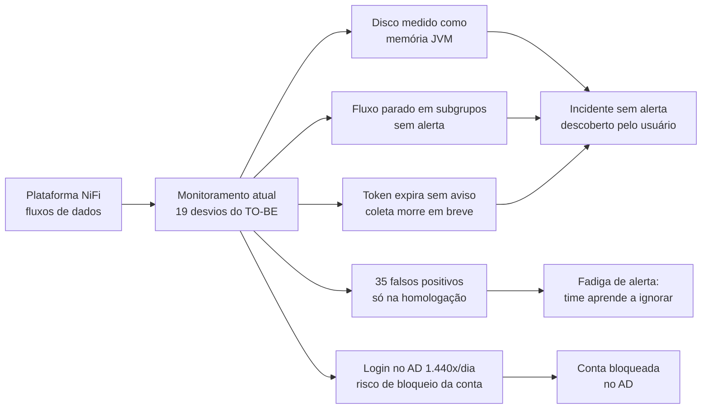
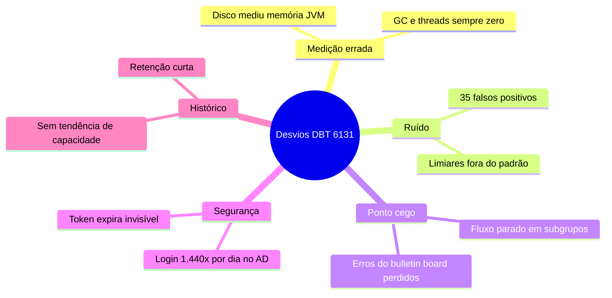
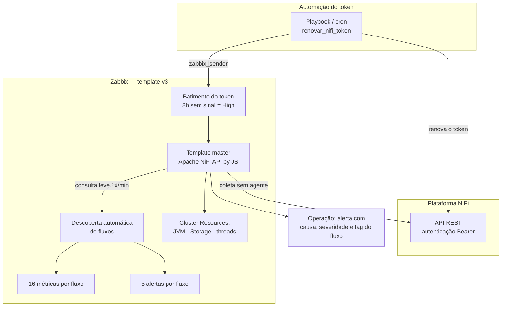
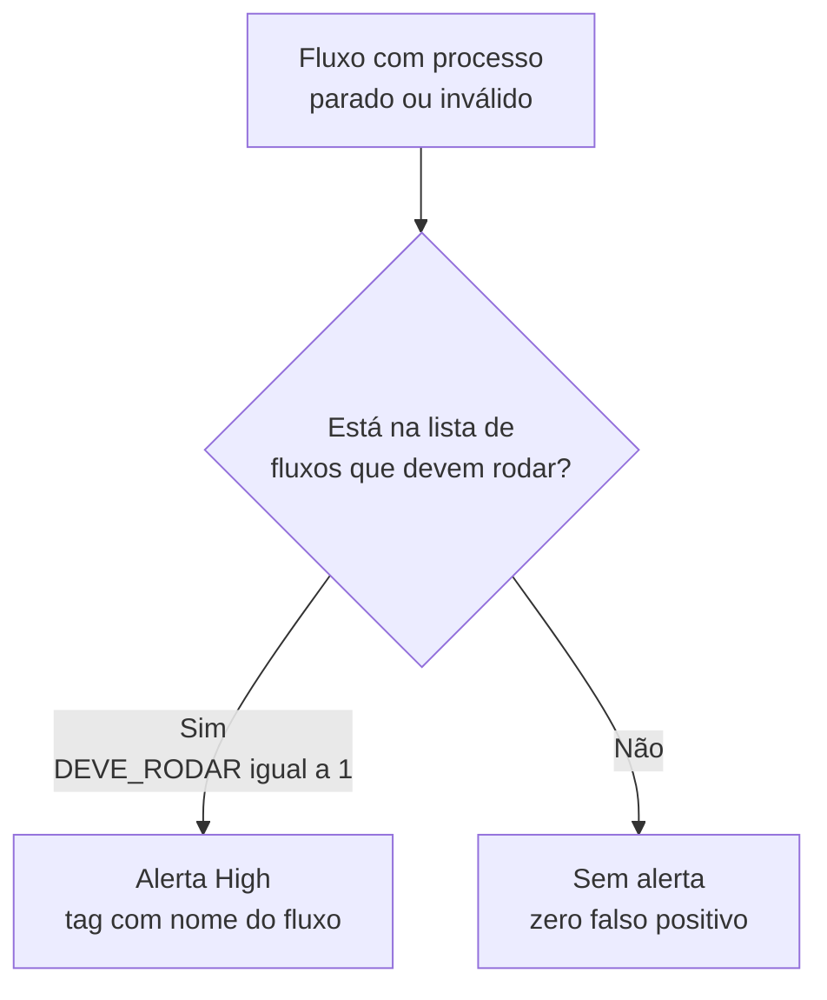
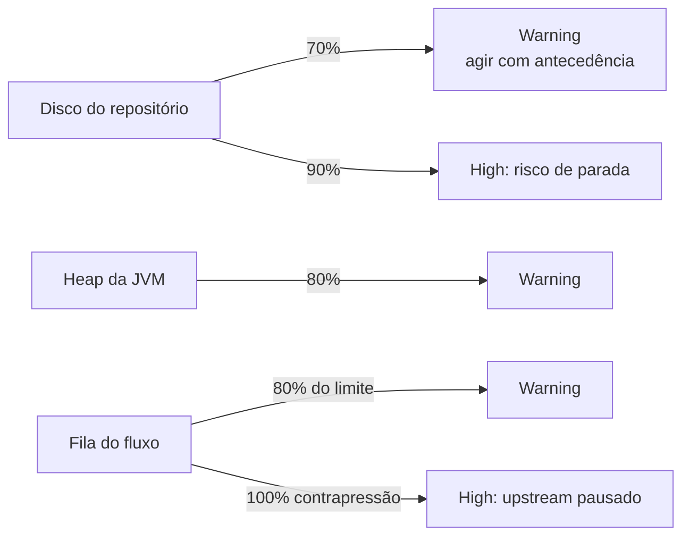
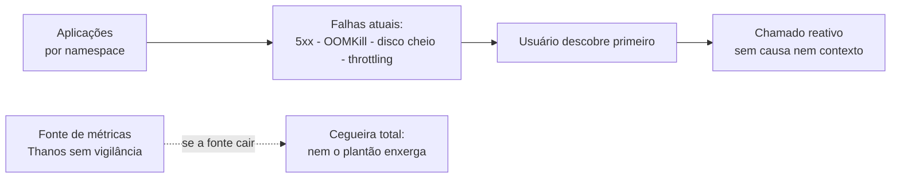
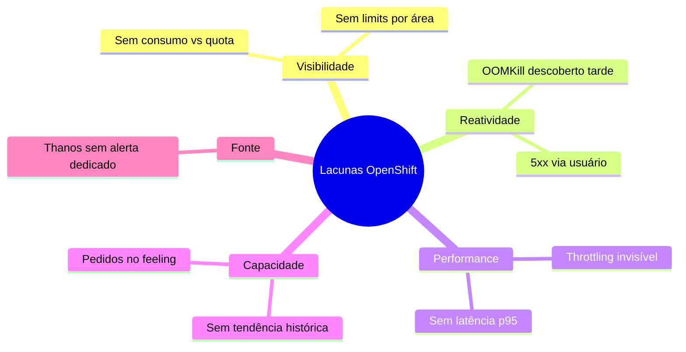
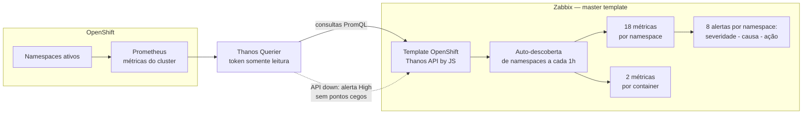
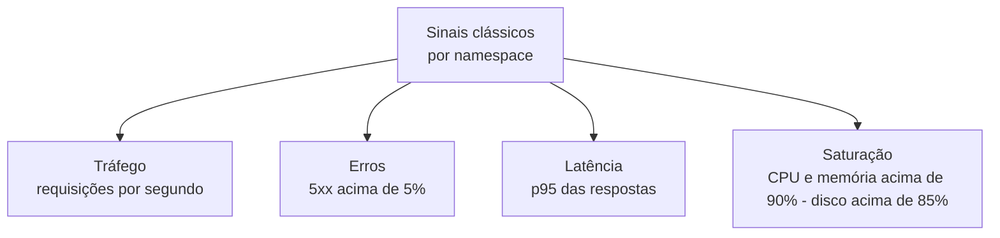
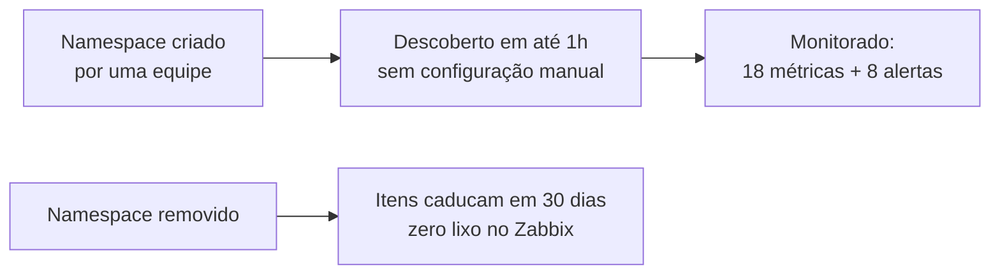

# Diagramas Mermaid — Roteiro Executivo de 2 Slides
## NiFi + OpenShift/Thanos

> **Como usar:** cole cada bloco em `mermaid.live`, no preview do VS Code/GitLab ou exporte PNG/SVG para o slide. Cada gráfico tem fala de apoio correspondente ao roteiro.

---

# Tema 1 — NiFi

## SLIDE 1 — Problemáticas analisadas

### Gráfico A (principal) — Cadeia de falhas do monitoramento atual

> **Fala:** "Tudo que sai à direita deste desenho é o que a gerência sente hoje: incidente sem aviso e alerta em que não se confia."

### Gráfico B — Categorização dos 19 desvios do TO-BE

---

## SLIDE 2 — Soluções implementadas

### Gráfico A (principal) — Arquitetura v3: da coleta ao alerta

> **Fala:** "Sem agente no NiFi, sem custo de licença: o Zabbix consulta a API e a descoberta cria métricas e alertas sozinhos."

### Gráfico B — Anti-ruído: quem tem direito a alerta

> **Fala:** "É este filtro simples que mata os falsos positivos: alerta só para o que precisa rodar — lista enviada pelo Desenvolvimento."

### Gráfico C — Escada de limiares: degradação antes do incidente

---

# Tema 2 — OpenShift / Thanos

## SLIDE 1 — Problemáticas analisadas

### Gráfico A (principal) — O incidente em rota direta para o usuário

> **Fala:** "Hoje o caminho é curto: a aplicação falha e o usuário descobre antes do plantão — e se a fonte sumir, nem isso o plantão sabe."

### Gráfico B — Lacunas por namespace

---

## SLIDE 2 — Soluções implementadas

### Gráfico A (principal) — Arquitetura: do namespace ao alerta

> **Fala:** "O Zabbix aponta para o Thanos que já existe no cluster; todo namespace novo entra em monitoração sozinho, sem trabalho por equipe."

### Gráfico B — Sinais clássicos cobertos em cada namespace

> **Fala:** "Os mesmos 4 sinais que a indústria usa para 'saúde de serviço' — agora por namespace, com alertas que já explicam causa e ação."

### Gráfico C — Ciclo de vida automático (zero manutenção)

